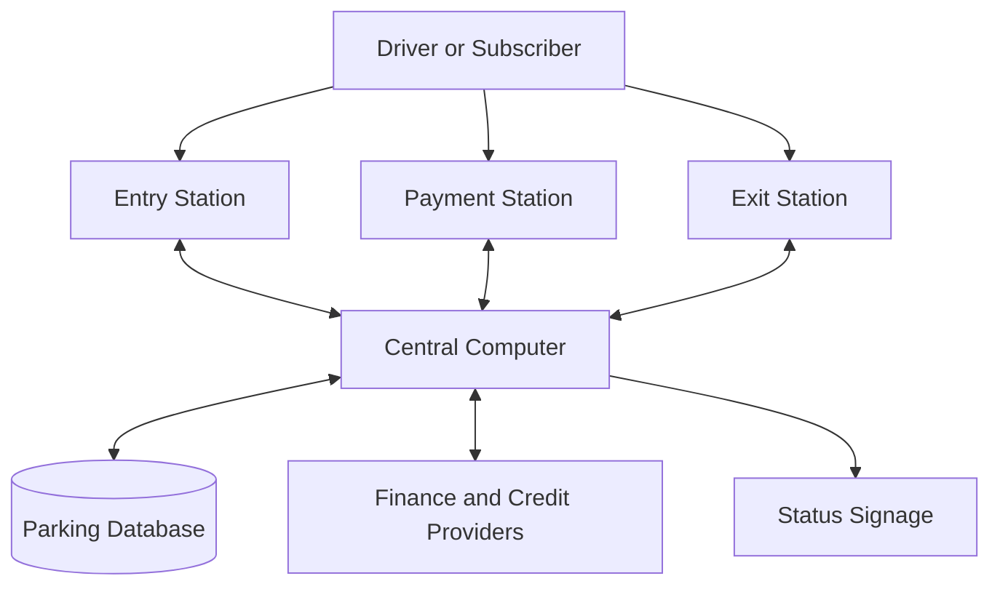

# Automated Parking Management System

**Academic software engineering project | The Hebrew University of Jerusalem**

A comprehensive **system design and planning** project for an automated parking management platform, documenting the lifecycle from requirements and architecture through software test planning, integration planning, and an individual feature extension.

> **Scope:** This portfolio documents planning and design deliverables, not a deployed production application. The academic work spans five-person team assignments and one individually submitted final project. It should not be construed as evidence of deployed software or a working hardware installation.

## Project at a glance

| Workstream | What was documented | Authorship |
|---|---|---|
| [01 — Requirements](docs/01-requirements.md) | User/system requirements, constraints, business rules, safety and payments | Five-person team |
| [02 — Software architecture](docs/02-software-design.md) | Components, interfaces, database tables and cross-component workflows | Five-person team |
| [03 — Test design](docs/03-software-testing.md) | Test tools, suites, scenarios, and requirements traceability | Five-person team |
| [04 — Integration plan](docs/04-integration-planning.md) | Phased integration of exit sensors, cameras, gates, payment hardware and failure handling | Five-person team |
| [05 — Guest-access feature extension](docs/05-individual-guest-access.md) | Subscriber guest bookings, quotas, billing rules, architecture updates, WBS and validation scenarios | **Individual final project — Tzachi Elya** |

Additional technical responses to exercise questions are in [supplementary documents](docs/).

## My contribution

- **System architecture (Exercise 2):** Responsible for the architecture section; collaborated on database design and processes.
- **Verification (Exercise 3):** Authored the entry-station test suite, from vehicle arrival to admission authorization, including requirements-to-tests traceability.
- **Integration (Exercise 4):** Co-planned the exit sensor, camera and exit gate integration stages.
- **Individual final:** Specified and designed the guest-access extension, including business rules, booking/cancellation journeys, charging rules, interface and data changes, a WBS, and test scenarios.

## System context

The proposed system links a central computer and database to entry, exit, payment and information stations. Business rules cover maximum parking occupancy, vehicle identification via camera or ticket, fee collection, reporting and safe operation. Fault handling addresses communications outages, equipment failure and business-continuity behavior.

## Individual extension: guest access

The standalone final submission considers how a subscriber could reserve access for a guest in advance, subject to an approved guest quota and defined time window. It includes cancellation behavior, requests for quota increases, associated guest charges and monthly billing breakdowns. The proposed change is decomposed into workstreams and connected to application, interface, database and test changes.

## Evidence and source notes

The files under [docs/](docs/) are **text-based archives of the provided academic PDF submissions** with identifying student numbers and other students' names suppressed for privacy. Because diagrams and layouts cannot be represented reliably in a text extraction, these files are accompanied by this README and are not substitutes for the original PDFs. The original eight PDF submissions were provided separately.

No implementation source code was part of these supplied files. Tools such as C++ and MySQL appear as **design constraints**, not verified implemented technologies.

---
**Relevant competencies:** requirements engineering · business rules · technical architecture · WBS · database/interface specifications · test design · integration dependencies · cross-team planning
